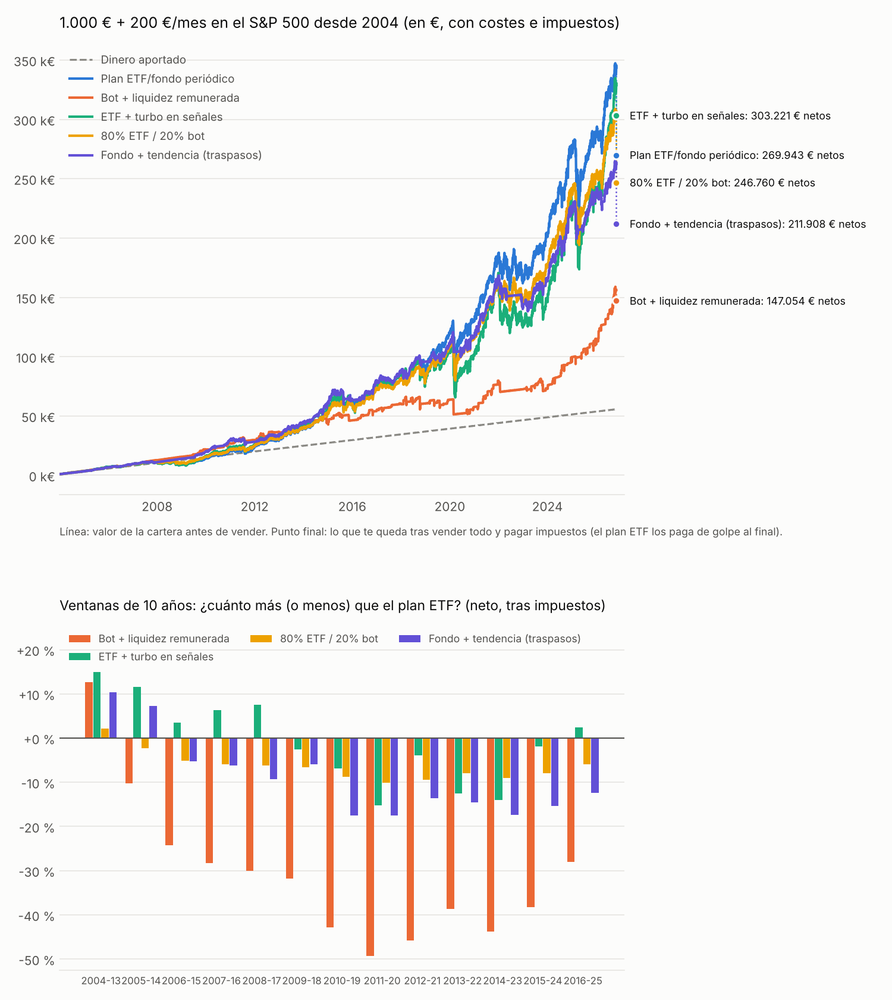

# swingbot — swing trading apalancado (x3 / x5) en índices

Bot en Python que **detecta entradas de swing corto** (de 1 a 10 sesiones, dentro
de la semana o del mes) en índices bursátiles, y un **motor de backtest** que
simula de forma realista productos apalancados x3 / x5.

> ⚠️ No es asesoramiento financiero. Los productos apalancados pueden perder
> gran parte de su valor en días. Opera sólo con dinero que puedas perder.

---

## 1. Respuesta honesta sobre el "5 % consistente"

Hemos probado el objetivo con 30 años de datos (1995-2026). Esto dicen los números:

| Lo que se busca | Lo que dicen los datos |
|---|---|
| +5 % **por operación** con x3 | Es alcanzable como *take profit* (el índice sólo tiene que subir ~1,7 %), pero sólo **~20-45 % de las operaciones** lo alcanzan antes de que la estrategia diga salir. La **media real por operación** es **+1 % / +1,2 %**. |
| +5 % **cada mes** de forma consistente | **No.** Ninguna configuración honesta lo consigue: sólo entre el 8 % y el 25 % de los meses superan +5 %. Hay meses sin señales y meses con pérdidas. |
| Ganar de forma consistente | **Sí, en el sentido estadístico**: 74-78 % de aciertos y *profit factor* ≈ 2 en el S&P 500, tanto en 1995-2014 como en 2015-2026 (fuera de muestra). |
| x5 | Aumenta la rentabilidad bruta, pero las caídas máximas del capital pasan del 30 % al 60-70 %. **No mejora la relación rentabilidad/riesgo**. Recomendado x3. |

Cualquier sistema que prometa +5 % al mes "consistente" con x3/x5 implicaría
>80 % anual: si existiera de forma fiable, lo habrían arbitrado los fondos.
Lo que sí existe es una **ventaja estadística pequeña y repetible** que el
apalancamiento multiplica (junto con el riesgo).

---

## 2. Estrategias (todas con fundamento publicado)

Todas son **sólo largos** y llevan un **filtro de régimen obligatorio**: sólo se
compra si el índice cierra **por encima de su media de 200 sesiones**. Con
apalancamiento, comprar caídas en un mercado bajista es la vía más rápida de
arruinar la cuenta.

| Estrategia | Entrada (al cierre) | Salida | Fundamento |
|---|---|---|---|
| `pullback` ✅ | 3 cierres bajistas seguidos | cierre > SMA5, máx. 10 sesiones | Reversión a la media tras caídas cortas dentro de tendencia alcista |
| `rsi2` ✅ | RSI(2) < 10 | cierre > SMA5, máx. 10 sesiones | Connors & Alvarez, *Short Term Trading Strategies That Work* (2008) |
| `ibs` | IBS < 0,2 y cierre < SMA5 | IBS > 0,8 o cierre > máximo previo | Pagonidis (2013), *The IBS Effect* |
| `tom` | 4 sesiones antes de fin de mes | cierre de la 3.ª sesión del mes | Efecto cambio de mes (Ariel 1987; Lakonishok & Smidt 1988) |
| `combo` | cualquiera de pullback/rsi2/ibs | cierre > SMA5 | Más operaciones, más riesgo |

✅ = **validadas** (profit factor ≥ 1,3 a x3 tanto en 1995-2014 como en 2015-2026).
El escáner sólo da señal de COMPRA para las validadas en cada índice.

Gestión de riesgo por defecto: **take profit +5 %** y **stop −10 %** sobre la
posición apalancada, y **salida obligatoria a las 10 sesiones** (nunca se pasa
del horizonte intra-mes).

---

## 3. Resultados (backtest 1995-2026, costes incluidos)

Costes simulados: 0,05 % por lado de comisión+deslizamiento, financiación del
apalancamiento al 4 % anual y comisión del ETP del 0,95 % anual. El producto x3
se modela con **reinicio diario** (como TQQQ/UPRO/3USL), por lo que el
*volatility decay* está incluido.

### S&P 500 — la configuración recomendada

| Estrategia | Lev. | Gestión | Ops/año | Aciertos | Media/op | Peor op | PF | CAGR | Máx. caída |
|---|---|---|---|---|---|---|---|---|---|
| pullback | x1 | — | 8,6 | 77 % | +0,4 % | −14 % | 2,28 | +3,3 % | −16 % |
| pullback | x3 | sin TP/SL | 8,6 | 77 % | +1,3 % | **−39 %** | 2,35 | +10,3 % | −42 % |
| **pullback** | **x3** | **TP5 % SL10 %** | 8,9 | 78 % | +1,2 % | **−10 %** | 2,26 | +10,5 % | −30 % |
| pullback | x3 | TP5 % SL10 % al 50 % del capital | 8,9 | 78 % | +1,2 % | −10 % | 2,26 | +5,3 % | −15 % |
| pullback | x5 | TP5 % SL10 % | 9,7 | 75 % | +1,1 % | −14 % | 1,58 | +9,5 % | −40 % |
| **rsi2** | **x3** | **TP5 % SL10 %** | 8,6 | 74 % | +1,2 % | −10 % | 2,03 | +9,8 % | −31 % |
| rsi2 | x5 | TP5 % SL10 % | 10,0 | 71 % | +0,9 % | −14 % | 1,39 | +7,1 % | −53 % |

*CAGR y caída máxima son de la cuenta completa: el capital sólo está invertido
~8 % del tiempo (operaciones de ~3 días), el resto está en liquidez.*

### Validación fuera de muestra (x3, TP5 %, SL10 %)

| Índice | Estrategia | PF 1995-2014 | PF 2015-2026 | Aciertos 2015+ | Media/op 2015+ |
|---|---|---|---|---|---|
| S&P 500 | pullback | 2,55 | 1,88 | 76 % | +0,9 % |
| S&P 500 | rsi2 | 2,06 | 1,99 | 76 % | +1,1 % |
| Nasdaq-100 | pullback | 1,65 | 1,43 | 70 % | +0,8 % |
| Nasdaq-100 | rsi2 | 1,44 | 1,35 | 67 % | +0,7 % |
| Euro Stoxx 50* | pullback | 1,40 | 1,86 | 73 % | +1,0 % |
| Euro Stoxx 50* | rsi2 | 1,54 | 1,62 | 74 % | +1,0 % |
| DAX 40 | rsi2 | **0,97** | 1,19 | 67 % | +0,4 % |

\*Euro Stoxx 50 con datos desde 2007. **El DAX no funciona** con estas reglas (coincide
con la literatura: la reversión a corto plazo es más fuerte en índices de EE.UU.).

Lecciones clave del histórico:

1. **El stop es imprescindible con apalancamiento.** Sin stop, la peor operación
   a x3 del S&P fue −39 % (agosto 2011) y a x5 −60 %. Con stop del 10 %, −10 %.
2. **x5 no compensa.** Los costes de financiación, el decay y los stops más
   frecuentes se comen la ventaja: menos *profit factor* y el doble de caída.
3. En el Nasdaq-100 el stop del 10 % es demasiado ajustado para su volatilidad
   (salta con ruido); funcionó mejor sin stop pero con peores operaciones de −19 %.
4. **El tamaño de posición es tu control de riesgo principal**: con x3 al 50 %
   del capital (exposición 1,5x) la caída máxima histórica fue del −15 %.

Las tablas completas (4 índices × 5 estrategias × x1/x3/x5 × 4 gestiones) están en
`reports/backtest_grid.csv` y `reports/out_of_sample.csv`.

---

## 4. Instalación y uso

```bash
pip install -r requirements.txt

# Señales de hoy (ejecutar ~15 min antes del cierre de EE.UU., 21:45 h en España,
# o tras el cierre para entrar en la apertura siguiente)
python -m swingbot scan
python -m swingbot scan --leverage 5 --symbols ^GSPC

# Backtest con los costes de Trade Republic, certificado factor, 2.000 €, resultado en €
python -m swingbot backtest ^GSPC pullback --broker trade_republic --product factor --capital 2000 --eur
python -m swingbot broker-report --broker trade_republic

# Backtest de una estrategia
python -m swingbot backtest ^GSPC pullback --leverage 3 --tp 0.05 --sl 0.10
python -m swingbot backtest ^NDX rsi2 --leverage 3 --sl none --trades
python -m swingbot backtest ^GSPC rsi2 --mode cfd --leverage 5 --entry next_open

# Informe completo de robustez (regenera reports/)
python -m swingbot report

# Bot frente a aportar periódicamente a un ETF (con impuestos) + gráfico
python -m swingbot compare --plot --initial 1000 --monthly 200

# Tests del motor
python -m pytest -q
```

Ejemplo de salida del escáner:

```
=== SEÑALES DE COMPRA (x3) ===
* S&P 500 [rsi2] cierre 7,580.07 (2026-10-30)
    RSI(2)=8.8 (entra < 10)
    Objetivo índice ~7,706.40 | Stop índice ~7,327.40 | Salida máx. 2026-11-13 o cuando la estrategia dé salida
    Instrumentos: UPRO / SPXL (EE.UU.), 3USL (WisdomTree, Europa)
```

Cómo operar una señal:
1. Comprar el producto x3 al cierre (orden *market-on-close*) o en la apertura siguiente.
2. Poner orden límite de venta a +5 % y stop a −10 % sobre el precio de compra del producto.
3. Cada día al cierre: si la estrategia da salida (cierre > SMA5) o se cumplen
   10 sesiones, cerrar. Lanzar `python -m swingbot backtest ... --trades` para ver
   cómo se comportaron operaciones parecidas.

---

## 5. Operar desde Trade Republic (o DEGIRO)

### Qué producto usar
Desde la UE **no se pueden comprar los ETFs apalancados de EE.UU.** (UPRO, TQQQ…)
porque no tienen KID (normativa PRIIPs). Las alternativas son:

| Producto | Cómo funciona | Modelo en el bot | Comentario |
|---|---|---|---|
| **Certificado factor Long 3x** ✅ | Palanca constante con reinicio diario, sin vencimiento | `--product factor` | **Recomendado**: es lo más parecido a lo que hemos probado. |
| Knock-out / Turbo Long | Palanca fija desde la compra; si el índice toca la barrera, el producto vale 0 | `--product knockout` | Funciona, pero algo peor y con riesgo de "quemarse". |
| ETP UCITS 3x (WisdomTree) | Como un ETF x3 europeo | `--product etp` | Comprueba si tu bróker lo tiene (ISIN IE00B7Y34M31 / IE00BLRPRL42). |

Busca en la app el índice + "Faktor Long 3x" o "Knock-out Long" y revisa en la
ficha el emisor, la palanca, la horquilla y el KID. El bot no puede comprobar el
catálogo de Trade Republic: te dice *qué* buscar, no un ISIN concreto.

**Horario:** Trade Republic negocia más o menos de 7:30 a 23:00 (hora de España), así
que puedes comprar unos 15 minutos antes del cierre de EE.UU. (22:00, o 21:00 en las
semanas de cambio de hora). Eso es justo lo que asume el backtest.

**Moneda:** un certificado en € sobre el S&P 500 o el Nasdaq no suele estar cubierto,
así que el EUR/USD también suma o resta. El backtest de bróker lo incluye.

### Resultados con costes de Trade Republic (2004-2026, en €)

Costes simulados: 1 € por orden, 0,15 % de horquilla por lado, financiación del
emisor al 5 % anual y comisión de gestión del 0,5 %. TP +5 %, SL −10 %.
Generado con `python -m swingbot broker-report` (tabla completa en
`reports/broker_trade_republic.csv`).

| Índice | Estrategia | Producto | Lev. | Capital | Aciertos | Media/op | PF | CAGR | Máx. caída | 500 € / 1.000 € / 10.000 € acaban en |
|---|---|---|---|---|---|---|---|---|---|---|
| **S&P 500** | **pullback** | **factor** | **x3** | 1.000 € | 76 % | +0,9 % | 2,03 | +8,0 % | −30 % | 2.355 / 5.797 / 67.749 € |
| S&P 500 | pullback | knockout | x3 | 1.000 € | 76 % | +0,8 % | 1,87 | +7,0 % | −33 % | 1.881 / 4.731 / 56.042 € |
| S&P 500 | pullback | factor | x5 | 1.000 € | 76 % | +1,0 % | 1,58 | +8,6 % | −45 % | 2.791 / 6.618 / 75.507 € |
| S&P 500 | rsi2 | factor | x3 | 1.000 € | 72 % | +0,7 % | 1,60 | +5,5 % | −33 % | 1.198 / 3.395 / 42.948 € |
| Nasdaq-100 | pullback | factor | x3 | 1.000 € | 73 % | +0,7 % | 1,43 | +5,6 % | −46 % | 1.234 / 3.510 / 44.490 € |
| Nasdaq-100 | rsi2 | knockout | x5 | 500 € | 63 % | −1,3 % | 0,64 | −12,5 % | −96 % | **23 €** (ruina) |

Conclusiones para Trade Republic:

1. **Configuración recomendada: S&P 500 + `pullback` + certificado factor Long x3.**
   Es la que mejor aguanta los costes reales.
2. **El 1 € por orden pesa en cuentas pequeñas**: con 500 € se pierde ~1,7 puntos
   de rentabilidad al año frente a 10.000 €. Por debajo de ~1.000 € compensa poco.
3. **x5 casi no añade rentabilidad y la caída máxima sube del 30 % al 45-60 %.**
4. El Nasdaq-100 con `rsi2` deja de compensar con los costes reales, y a x5 con
   knock-outs llegó a arruinar la cuenta.
5. **DEGIRO:** `--broker degiro` simula 2 € por orden. Comprueba si en tu país
   ofrece certificados factor o sólo turbos/sprinters.

### Cómo operar una señal en Trade Republic
1. Ejecuta `python -m swingbot scan` hacia las 21:40 (hora de España; 20:40 en las
   semanas de cambio de hora).
2. Si hay **SEÑAL**, compra el certificado factor Long 3x del índice antes de las 22:00.
3. Pon una **orden límite de venta a +5 %** y una **orden stop a −10 %** sobre tu precio de compra.
4. Cada tarde, al cierre: si el índice cierra por encima de su media de 5 días, o han
   pasado 10 sesiones, vende.

---

## 6. ¿Gana más que aportar periódicamente a un ETF o fondo?

`python -m swingbot compare --plot` simula **las mismas aportaciones** (1.000 € al
principio + 200 €/mes) en seis opciones. Todo en euros, con costes e **impuestos
españoles** (escala del ahorro 19-28 %). El plan ETF/fondo incluye dividendos y
sólo paga impuestos al vender al final; el bot paga cada año porque vende en cada
operación. La liquidez cobra el tipo del euro de cada año (negativo en 2015-2021).
Puedes cambiar las cantidades: `--initial 5000 --monthly 300 --start 2010`.



**2004-2026 (1.000 € + 200 €/mes = 55.600 € aportados):**

| Opción | Valor final neto | Impuestos | TIR anual | Peor caída |
|---|---|---|---|---|
| **Plan ETF / fondo indexado periódico** | **269.943 €** | 66.784 € | **+11,9 %** | −51 % |
| Bot solo x3 (Trade Republic) | 133.908 € | 19.499 € | +6,9 % | −29 % |
| Bot + liquidez remunerada | 147.054 € | 22.913 € | +7,6 % | −30 % |
| ETF + turbo en señales | 303.221 € | 65.745 € | +12,7 % | −51 % |
| 80 % ETF / 20 % bot | 246.760 € | 55.861 € | +11,3 % | −41 % |
| Fondo + tendencia (traspasos, MyInvestor) | 211.908 € | 45.319 € | +10,3 % | **−21 %** |

**Repetido en todas las ventanas de 10 años (2004-13 … 2016-25):**

| Opción | Gana al plan | Diferencia media | Peor / mejor ventana |
|---|---|---|---|
| Bot solo | 1 de 13 | −32 % | −49 % / +6 % |
| Bot + liquidez remunerada | 1 de 13 | −31 % | −49 % / +13 % |
| ETF + turbo en señales | 6 de 13 | −0,8 % | −15 % / +15 % |
| 80 % ETF / 20 % bot | 1 de 13 | −6 % | −10 % / +2 % |
| Fondo + tendencia (traspasos) | 2 de 13 | −9 % | −18 % / +10 % |

"Fondo + tendencia": el último día de cada mes, si el S&P 500 está por encima de su
media de 200 sesiones, el dinero está en un fondo indexado; si no, se traspasa a un
fondo monetario (Faber, 2007). En España **los traspasos entre fondos no tributan**,
así que esta estrategia no tiene el problema fiscal del bot. Se simula con 3 sesiones
de retraso por traspaso.

Conclusiones:

1. **Ninguna estrategia activa gana de forma fiable a aportar cada mes a un indexado.**
2. El bot solo pierde claramente: el dinero está parado el ~92 % del tiempo.
3. "ETF + turbo" es una moneda al aire tras impuestos.
4. "Fondo + tendencia" gana algo menos (−9 % de media en 10 años), pero **reduce la
   peor caída del −51 % al −21 %**. Si lo que te importa es no ver tu dinero a la
   mitad en una crisis, es la opción más interesante.
5. Para un inversor en España con aportaciones periódicas: **la base debe ser un
   fondo indexado** (mejor que un ETF, por los traspasos sin impuestos).

### ¿Trade Republic o MyInvestor?

| Para… | Mejor opción | Por qué |
|---|---|---|
| Aportar cada mes al S&P 500 / MSCI World | **MyInvestor (fondo indexado)** | Fondos sin comisión de compra ni custodia y **traspasables sin pagar impuestos**: puedes cambiar de fondo o reequilibrar sin tocar Hacienda. Un ETF siempre tributa al vender. |
| Estrategia de tendencia (fondo ↔ monetario) | **MyInvestor** | Sólo es viable con fondos por los traspasos; mejor con fondos de la misma gestora (traspaso *switch*, más rápido). |
| El bot de swing x3 | **Trade Republic** | Tiene certificados factor / knock-outs, comisión fija de 1 € y horario hasta las 23:00. En MyInvestor no encontré productos apalancados y los ETFs cuestan 0,12 % por operación (mín. 1 €). |
| Liquidez | Cualquiera que la remunere | — |

Limitaciones: la regla española de los 2 meses (no compensar pérdidas si recompras
el mismo valor) no está modelada y perjudicaría aún más a las opciones activas.
Los tipos del euro por año son aproximados. Los traspasos pueden tardar más de 3
sesiones entre gestoras distintas (8-15 días naturales según usuarios) y algunas
gestoras limitan los traspasos frecuentes. El certificado factor se simula sin
dividendos (supuesto conservador).

---

## 7. Estructura

```
swingbot/
  data.py        descarga (Yahoo Finance) con caché local
  indicators.py  SMA, RSI de Wilder, ATR, IBS, rachas, calendario de mes
  strategies.py  las 5 estrategias y el filtro de régimen
  backtest.py    motor: apalancamiento ETF (reinicio diario) o CFD (fijo), TP/SL
                 intradía con gaps, costes, financiación, liquidación, métricas
  scanner.py     señales del día
  report.py      rejilla de robustez + validación fuera de muestra
  compare.py     bot frente a plan ETF/fondo periódico y tendencia con traspasos (impuestos, gráfico)
  config.py      índices, instrumentos, brókers (TR / DEGIRO), productos y parámetros
tests/           tests del motor (apalancamiento, TP/SL, gaps)
```

Supuestos conservadores del motor: si en un mismo día se tocan TP y stop se
asume el stop; los gaps de apertura se ejecutan en la apertura (el stop no
protege de un gap); las señales sólo usan datos hasta el cierre del día.

## 8. Próximos pasos posibles

- Avisos automáticos (Telegram / email) con el escáner programado cada día.
- Stop dinámico por volatilidad (ajustado al Nasdaq).
- Conexión a un bróker (Interactive Brokers) para ejecución automática, primero en cuenta demo.
- Operar 3-6 meses en papel antes de poner dinero real y comparar con el backtest.
